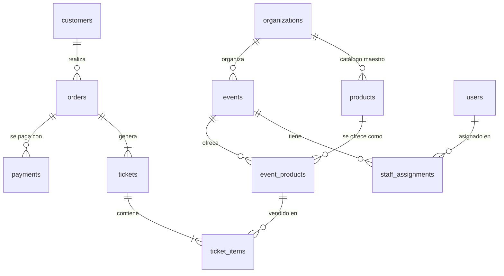
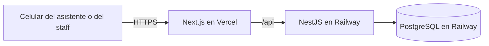

# Informe Final · DrinkoWebApp

> Borrador. Se exporta a PDF para la entrega. Los textos entre corchetes `[...]` los completa el equipo.

## Portada

- **Universidad y carrera**: Universidad Tecnológica Nacional · Tecnicatura Universitaria en Programación
- **Materia**: Proyecto Final
- **Proyecto**: DrinkoWebApp · Sistema ágil de compra en barras de eventos
- **Grupo**: G206
- **Integrantes**: Javier Isaias Ovelar y Gastón Paschetta
- **Tutor**: Oscar Londero
- **Año**: 2026
- **Repositorio**: https://github.com/paschedev/DrinkoWebApp (versión entregada: tag `[v1.0.0]`)
- **Sistema desplegado**: [link de Vercel]
- **Video**: [link del video]

## 1. Problema y contexto

En las barras de eventos masivos y discotecas, comprar una bebida implica hacer una fila larga, gritar el pedido con mucho ruido, esperar el cobro con tarjeta, QR o efectivo y, recién después, recibir la bebida. El asistente pierde tiempo, y el organizador vende menos por hora porque la barra se convierte en un cuello de botella.

**Actores**:
- **Asistente**: compra desde su celular, sin crear una cuenta.
- **Staff de barra**: escanea los tickets y entrega lo comprado.
- **Organizador**: la productora del evento; define precios, stock y disponibilidad.

**Hipótesis central**: la demora principal está en *pedir y cobrar*, no en *preparar*. Servir una bebida lleva poco tiempo; lo que frena la fila es escuchar el pedido, cobrar y esperar la aprobación del pago.

**Evidencia**: entrevistamos a un productor de eventos [nombre y fecha de la entrevista]. Según su experiencia, por varios factores, el mayor cuello de botella al servir bebidas en fiestas, festivales y eventos está en la venta: el cliente consulta qué hay disponible, decide, paga y espera el vuelto. Preparar y entregar la bebida lleva mucho menos tiempo.

La entrevista también mostró un efecto sobre la venta. En la barra, el cliente suele pedir rápido algo de consumo común que ya tenía en mente. Si hubiera visto el catálogo completo, quizás habría elegido un producto especial que no imaginaba que estuviera disponible.

**Necesidad**: sacar el pedido y el pago de la barra y pasarlos al celular del asistente, de modo que en la barra quede una sola fila de retiro, donde el pedido llega ya pagado. El asistente compra desde la pista, la mesa o su asiento, ve todos los productos con sus precios y retira cuando quiere.

El sistema no reemplaza por completo a la venta tradicional: el evento puede mantener una caja para efectivo u otros medios de pago. La diferencia es que la demanda se reparte entre la caja y los celulares, en lugar de concentrarse en la barra.

## 2. Objetivos y alcance

**Objetivo general**: que el asistente compre desde su celular escaneando el QR del evento, pague y retire en la barra mostrando un QR, y que la barra solo entregue.

**Alcance implementado** (el recorrido completo que pidió el tutor):

evento en curso → QR de acceso → catálogo → carrito dividido en tickets → reserva de stock → pago simulado → tickets activos con QR → el staff escanea → canje.

Además: login de organizadores y staff, panel de precio, stock y disponibilidad durante el evento, y la demanda pendiente por producto ("Gin tonic: 3 por entregar").

**Fuera de alcance de esta entrega** (recortado para priorizar un recorrido estable y probado):
- Panel del Organizador con ABM de catálogo, eventos y staff. Los datos de ejemplo se cargan con el seed.
- Alta de staff por invitación.
- Integración con Mercado Pago. **El pago es simulado**: el cliente elige "aprobar" o "rechazar".
- Historial de eventos y métricas de venta.
- Aplicaciones nativas (fuera de alcance desde el inicio).

## 3. Análisis y modelo

**Entidades principales** (diagrama completo en [`database/der.md`](../database/der.md)):

**Reglas de negocio**:
- Cada evento toma productos del catálogo maestro y define su precio, su disponibilidad y, opcionalmente, un stock. Un stock `NULL` significa sin control.
- Todas las barras de un evento comparten el mismo stock: el evento funciona como una única unidad lógica de entrega.
- Se pueden pedir hasta 10 unidades de un producto por ticket. Para validar el stock se suma todo el pedido, aunque el mismo producto esté en varios tickets.
- El stock se reserva al confirmar el pedido. La reserva vence a los 10 minutos o al fin del evento, lo que ocurra antes.
- Pedido, tickets e ítems se crean juntos en estado pendiente. Al aprobarse el pago, los tickets se activan con un número visible y un token aleatorio de 128 bits, que es el contenido del QR de retiro.
- Ticket al portador: lo retira quien muestre el QR, completo y de una sola vez. Se puede canjear hasta 1 hora después del fin del evento.
- Cada ítem guarda el nombre y el precio del producto al momento de la compra: un cambio de precio posterior no altera lo ya vendido.
- [A definir por el equipo: control de edad para bebidas alcohólicas. Por ejemplo, si se asume controlado en el ingreso al evento, o si el staff puede negar la entrega al retirar.]

**Decisiones de modelado importantes**:
- Separación entre catálogo maestro (`products`) y oferta del evento (`event_products`).
- Separación entre pedido, pago y ticket. Un pedido puede tener varios tickets, para retirar en momentos distintos.
- Los estados que dependen de la hora (evento en curso, ticket vencido) se calculan con la hora del servidor y no se guardan.
- Las reglas que dependen de la concurrencia se apoyan en la base: índices únicos parciales (un pedido pendiente por cliente y evento, un pago aprobado por pedido) y `CHECK` (stock no negativo, cantidades entre 1 y 10).

## 4. Arquitectura y tecnologías

| Componente | Responsabilidad | Por qué |
|---|---|---|
| Next.js + TypeScript | Pantallas del cliente y de la barra. Reenvía `/api` al backend. | Carga rápida al escanear el QR. Al reenviar `/api`, las cookies quedan en el mismo dominio que la página. |
| NestJS + TypeScript | API REST organizada en módulos: eventos, pedidos, pagos, tickets, oferta y autenticación. | Estructura modular y tipada; maneja bien muchas peticiones a la vez. |
| PostgreSQL | Datos y garantías de consistencia. | Transacciones y `UPDATE` condicionales para resolver la concurrencia en la base. |
| Prisma | Acceso a datos y migraciones. | Tipos generados desde el esquema y migraciones versionadas. |

Se eligió un monolito modular y no microservicios: para un equipo de dos personas es más simple de desarrollar, probar y desplegar.

**Seguridad**:
- **Cliente sin cuenta**: se identifica con un secreto aleatorio guardado en una cookie httpOnly. En la base solo se guarda su hash.
- **Organizadores y staff**: entran con email y contraseña (hash Argon2id). La sesión se guarda en la base y solo se almacena el hash del token, así que cerrar sesión o desactivar un usuario la invalida en el momento. Un email inexistente y una contraseña incorrecta reciben el mismo mensaje.
- **Autorización**: el staff opera solo en los eventos a los que está asignado, y un organizador solo en los de su productora. Los recursos de productoras distintas no se pueden cruzar, y hay tests que lo verifican.
- **Validación**: todas las entradas se validan en el servidor y se rechazan los campos desconocidos. El total del pedido lo calcula el servidor, nunca el navegador. Los errores no exponen detalles internos.

**Concurrencia**: ver la sección 6.

## 5. Implementación

**Módulos del backend** (`backend/src/modules`):
- `events`: catálogo del evento.
- `customers`: cookie del cliente.
- `orders`: pedido, reserva y vencimiento.
- `payments`: pago simulado.
- `tickets`: mis tickets y canje.
- `offers`: precio, stock, disponibilidad y demanda pendiente.
- `auth`: login, sesiones y permisos por evento.

**Recorrido de compra**:
1. El asistente escanea el QR de acceso y abre el catálogo (`/e/[code]`). [Captura]
2. Arma el carrito y, si quiere, lo divide en tickets (`/e/[code]/cart`). [Captura]
3. Al confirmar, el backend crea el pedido y reserva el stock en una sola transacción.
4. En la pantalla de pago simulado ve el tiempo que le queda a la reserva y paga (`/e/[code]/payment/[id]`). [Captura]
5. Con el pago aprobado, sus tickets aparecen activos, cada uno con su QR (`/tickets`). [Captura]

**Recorrido de la barra**:
1. El staff ingresa (`/login`) y elige su evento.
2. Escanea el QR con la cámara del celular (`/bar/[eventId]/scan`). Ve en verde el número del ticket y qué entregar, o en rojo el motivo del rechazo. [Captura]
3. Ajusta precio, stock o disponibilidad durante el evento (`/bar/[eventId]/products`). Cada cambio queda registrado. [Captura]
4. Consulta lo vendido que todavía no se retiró (`/bar/[eventId]/demand`). [Captura]

**Dificultades y cómo se resolvieron**:
- *Reservar varios productos sin quedar a medias*: el pedido se reserva dentro de una transacción. Cada producto se descuenta con un `UPDATE ... WHERE stock >= cantidad`; si alguno falla, se revierte todo.
- *Numerar tickets sin repetir*: cada pago reserva un bloque de números con un único `UPDATE events SET last_ticket_number = last_ticket_number + n`, que bloquea la fila del evento.
- *Liberar reservas vencidas una sola vez*: el proceso que corre cada 30 segundos solo cambia un pedido si sigue pendiente. Si corre dos veces, o a la vez que un pago, no devuelve el stock dos veces.
- *Reglas que Prisma no puede declarar*: las restricciones `CHECK`, los índices parciales y las vistas se agregaron a mano en la migración inicial. Se verificó que la base resultante es igual a la de `database/ddl.sql`.
- [Agregar otras dificultades que encuentren en el deploy o con la cámara.]

## 6. Pruebas y validación

Las pruebas corren contra una base PostgreSQL real, no contra simulaciones, porque las garantías de concurrencia las da la base. Se ejecutan con `npm test` en `backend/`. Resultado de la última corrida: **46 tests, todos pasan**.

**Reglas críticas probadas**:

| Regla | Caso de prueba | Resultado |
|---|---|---|
| Última unidad | 30 compras simultáneas con stock 10 | Exactamente 10 pedidos; stock final 0 |
| Doble escaneo | 50 escaneos simultáneos del mismo QR desde 5 staff | Exactamente 1 canje |
| Numeración | 15 pagos simultáneos de 2 tickets cada uno | Números del 1 al 30 sin repetir |
| Reserva de todo o nada | Cerveza con stock y agua sin stock en el mismo pedido | No se reserva nada |
| Mismo producto en varios tickets | 2 + 2 cervezas con stock 3 | Rechazado; el stock no cambia |
| Vencimiento de la reserva | El proceso de vencimiento corre dos veces | El stock se devuelve una sola vez |
| Aprobación tardía | Pago aprobado después del vencimiento | Rechazado; el pedido pasa a EXPIRED y se libera el stock |
| Doble cobro | Segundo pago del mismo pedido | Rechazado |
| Canje | Ticket ya retirado, vencido, de otro evento o sin pagar, y staff no asignado | Rechazado, con el motivo |
| Productoras distintas | Producto de otro evento en el pedido; organizador de otra productora | Rechazado (400, 403 o 404) |

**Las pruebas detectan errores reales**: para comprobarlo, se reemplazaron temporalmente la numeración y el canje por versiones ingenuas de "leer, verificar y guardar". Con esas versiones, los tests fallaron. En el canje, el mismo ticket se entregó 50 veces. En la numeración, dos pagos intentaron usar el mismo número y la base rechazó el duplicado por el índice único `(event_id, number)`. Con el código real, los tests pasan.

**Validación manual**: se recorrió en el navegador, a tamaño de celular, el escenario de ejemplo del README:
- 2 cervezas y 1 gin tonic en un ticket, y el agua en otro.
- Pago y 2 tickets activos con su QR.
- Canje del primer ticket en verde; un segundo intento sale en rojo con la hora del retiro.
- El stock y la demanda pendiente cambiaron como se esperaba.

[Completar: prueba del escáner con la cámara de celulares reales sobre el deploy, prueba con conectividad degradada y validación con usuarios, si la hay.]

## 7. Resultados y conclusiones

**Qué se logró**: el recorrido completo de compra y retiro funciona de punta a punta. Las garantías más importantes (no vender de más, no canjear dos veces, no cobrar dos veces) están demostradas con pruebas de concurrencia, no solo afirmadas.

**Qué cambia respecto de la situación inicial**: el pedido y el cobro salen de la barra. La barra recibe tickets ya pagados y sabe de antemano qué tiene pendiente de entregar. Para el organizador, eso significa más ventas por hora. Para el público, significa esperar menos, comprar sin moverse de su lugar y ver todo lo que hay disponible, incluidos productos que en la barra quizás no habría pedido.

**Limitaciones conocidas**:
- El pago es simulado; no hay integración con una pasarela real.
- No hay pantallas de administración: productoras, catálogo, eventos y staff se cargan con el seed.
- El ticket es al portador: quien tenga una captura del QR puede retirarlo. Se mitiga mostrando al staff el número y el contenido al canjear.
- El cliente ve sus tickets solo desde el navegador donde compró, porque la cookie queda en ese navegador.
- No hay límite de intentos de login.
- [Agregar las que surjan de las pruebas en celulares y con conectividad degradada.]

**Evolución futura**: Panel del Organizador con ABM, invitaciones de staff, Mercado Pago, métricas de venta en tiempo real, límite de intentos y QR rotativo para mitigar capturas.

**Aprendizajes**: [Completar por el equipo.]

## 8. Uso de herramientas de IA

Usamos herramientas de IA como asistente para revisar el proyecto, documentarlo, proponer mejoras y asistir en la implementación del código. Todas las decisiones de arquitectura y diseño fueron del equipo, que revisó cada cambio antes de incorporarlo.

## 9. Enlace al video

[Link del video de presentación]
