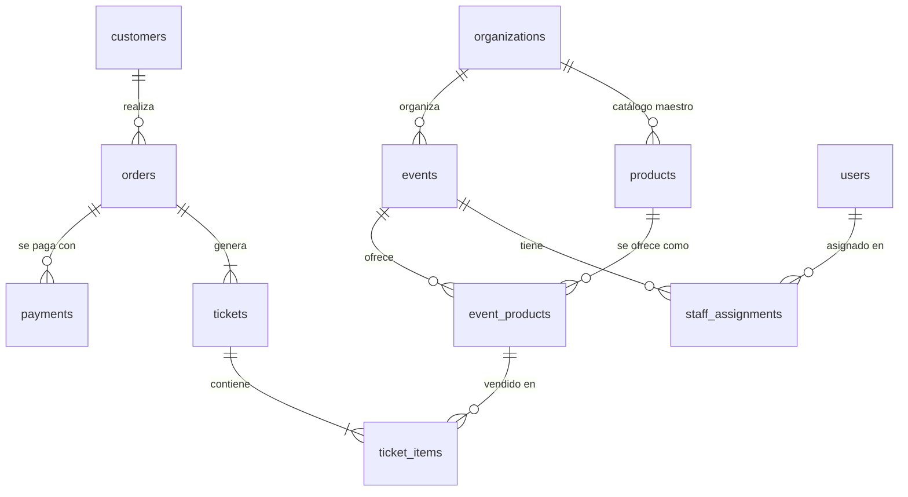
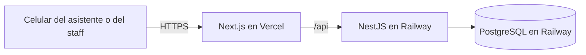

# Informe Final · DrinkoWebApp

> Borrador. Se exporta a PDF para la entrega. Los textos entre corchetes `[...]` los completa el equipo.

## Portada

- **Universidad y carrera**: Universidad Tecnológica Nacional · Tecnicatura Universitaria en Programación
- **Materia**: Proyecto Final
- **Proyecto**: DrinkoWebApp · Sistema ágil de compra en barras de eventos
- **Grupo**: G206
- **Integrantes**: Javier Isaias Ovelar y Gastón Paschetta
- **Tutor**: Oscar Londero
- **Año**: 2026
- **Repositorio**: https://github.com/paschedev/DrinkoWebApp (versión entregada: tag `[v1.0.0]`)
- **Sistema desplegado**: https://drinko-beryl.vercel.app
  - Evento de prueba: https://drinko-beryl.vercel.app/e/k7f3q9mx (QR en `docs/qr-evento-demo.svg`)
  - Barra: https://drinko-beryl.vercel.app/login (`staff1@drinko.test` / `drinko-demo-2026`, cuenta ficticia)
  - Panel del Organizador: el mismo login con `organizador@drinko.test` y la misma contraseña
- **API**: https://drinkowebapp-production.up.railway.app
- **Video**: [link del video]

## 1. Problema y contexto

En las barras de eventos masivos y discotecas, comprar una bebida implica hacer una fila larga, gritar el pedido con mucho ruido, esperar el cobro con tarjeta, QR o efectivo y, recién después, recibir la bebida. El asistente pierde tiempo, y el organizador vende menos por hora porque la barra se convierte en un cuello de botella.

**Actores**:
- **Asistente**: compra desde su celular, sin crear una cuenta.
- **Staff de barra**: escanea los tickets, entrega lo comprado y ajusta precio, stock y disponibilidad durante el evento.
- **Organizador**: la productora del evento; administra su catálogo, crea los eventos, asigna al staff y define la oferta de cada evento.

**Hipótesis central**: la demora principal está en *pedir y cobrar*, no en *preparar*. Servir una bebida lleva poco tiempo; lo que frena la fila es escuchar el pedido, cobrar y esperar la aprobación del pago.

**Evidencia**: entrevistamos a un productor de eventos, conocido del equipo. Según su experiencia, por varios factores, el mayor cuello de botella al servir bebidas en fiestas, festivales y eventos está en la venta: el cliente consulta qué hay disponible, decide, paga y espera el vuelto. Preparar y entregar la bebida lleva mucho menos tiempo.

La entrevista también mostró un efecto sobre la venta. En la barra, el cliente suele pedir rápido algo de consumo común que ya tenía en mente. Si hubiera visto el catálogo completo, quizás habría elegido un producto especial que no imaginaba que estuviera disponible.

**Necesidad**: sacar el pedido y el pago de la barra y pasarlos al celular del asistente, de modo que en la barra quede una sola fila de retiro, donde el pedido llega ya pagado. El asistente compra desde la pista, la mesa o su asiento, ve todos los productos con sus precios y retira cuando quiere.

El sistema no reemplaza por completo a la venta tradicional: el evento puede mantener una caja para efectivo u otros medios de pago. La diferencia es que la demanda se reparte entre la caja y los celulares, en lugar de concentrarse en la barra.

## 2. Objetivos y alcance

**Objetivo general**: que el asistente compre desde su celular escaneando el QR del evento, pague y retire en la barra mostrando un QR, y que la barra solo entregue.

**Alcance implementado** (el recorrido completo que pidió el tutor):

evento en curso → QR de acceso → catálogo → carrito dividido en tickets → reserva de stock → pago simulado → tickets activos con QR → el staff escanea → canje.

Además:
- **Barra**: login de organizadores y staff, panel de precio, stock y disponibilidad durante el evento, y la demanda pendiente por producto ("Gin tonic: 3 por entregar").
- **Panel del Organizador**: crear, editar y eliminar eventos según su estado, QR de acceso para imprimir, asignación del staff, catálogo maestro de productos y armado de la oferta de cada evento.
- **Cliente**: cancelar el pedido pendiente, duplicar o dividir un ticket, repetir una compra e historial de tickets retirados y vencidos.

**Fuera de alcance de esta entrega** (recortado para priorizar un recorrido estable y probado):
- Alta de productoras y de usuarios de staff. Se cargan con el seed; el organizador asigna al evento el staff que ya existe.
- Integración con Mercado Pago. **El pago es simulado**: el cliente elige "aprobar" o "rechazar".
- Métricas de venta y resumen de lo vendido por evento. El panel lista los eventos finalizados, pero solo para consulta.
- Aplicaciones nativas (fuera de alcance desde el inicio).

## 3. Análisis y modelo

**Entidades principales** (diagrama completo en [`database/der.md`](../database/der.md)):



**Reglas de negocio**:
- Cada evento toma productos del catálogo maestro y define su precio, su disponibilidad y, opcionalmente, un stock. Un stock `NULL` significa sin control.
- Todas las barras de un evento comparten el mismo stock: el evento funciona como una única unidad lógica de entrega.
- Se pueden pedir hasta 10 unidades de un producto por ticket. Para validar el stock se suma todo el pedido, aunque el mismo producto esté en varios tickets.
- El stock se reserva al confirmar el pedido. La reserva vence a los 10 minutos o al fin del evento, lo que ocurra antes.
- Pedido, tickets e ítems se crean juntos en estado pendiente. Al aprobarse el pago, los tickets se activan con un número visible y un token aleatorio de 128 bits, que es el contenido del QR de retiro.
- Ticket al portador: lo retira quien muestre el QR, completo y de una sola vez. Se puede canjear hasta 1 hora después del fin del evento.
- Cada ítem guarda el nombre y el precio del producto al momento de la compra: un cambio de precio posterior no altera lo ya vendido.
- Control de edad para bebidas alcohólicas: se asume que lo hace el evento en el ingreso. La compra es anónima y el ticket es al portador, así que pagar no autoriza por sí solo la entrega. El sistema no verifica identidades.

**Decisiones de modelado importantes**:
- Separación entre catálogo maestro (`products`) y oferta del evento (`event_products`).
- Separación entre pedido, pago y ticket. Un pedido puede tener varios tickets, para retirar en momentos distintos.
- Los estados que dependen de la hora (evento en curso, ticket vencido) se calculan con la hora del servidor y no se guardan.
- Las reglas que dependen de la concurrencia se apoyan en la base: índices únicos parciales (un pedido pendiente por cliente y evento, un pago aprobado por pedido) y `CHECK` (stock no negativo, cantidades entre 1 y 10).
- Cancelar un pedido pendiente lo pasa a `EXPIRED` (vencido) y libera la reserva, igual que el vencimiento por tiempo. No hizo falta un estado nuevo.
- Lo que depende del estado del evento se valida en el servidor: un evento programado se edita completo; uno en curso solo cambia el nombre o extiende el fin; uno finalizado es de solo lectura. Un evento se elimina solo si nunca empezó y no tiene pedidos, y un producto que ya se ofreció en un evento se archiva en lugar de borrarse.

## 4. Arquitectura y tecnologías



| Componente | Responsabilidad | Por qué |
|---|---|---|
| Next.js + TypeScript | Pantallas del cliente, de la barra y del Panel del Organizador. Reenvía `/api` al backend. | Carga rápida al escanear el QR. Al reenviar `/api`, las cookies quedan en el mismo dominio que la página. |
| NestJS + TypeScript | API REST organizada en módulos: catálogo, eventos, oferta, pedidos, pagos, tickets y autenticación. | Estructura modular y tipada; maneja bien muchas peticiones a la vez. |
| PostgreSQL | Datos y garantías de consistencia. | Transacciones y `UPDATE` condicionales para resolver la concurrencia en la base. |
| Prisma | Acceso a datos y migraciones. | Tipos generados desde el esquema y migraciones versionadas. |

Se eligió un monolito modular y no microservicios: para un equipo de dos personas es más simple de desarrollar, probar y desplegar.

**Seguridad**:
- **Cliente sin cuenta**: se identifica con un secreto aleatorio guardado en una cookie httpOnly. En la base solo se guarda su hash.
- **Organizadores y staff**: entran con email y contraseña (hash Argon2id). La sesión se guarda en la base y solo se almacena el hash del token, así que cerrar sesión o desactivar un usuario la invalida en el momento. Un email inexistente y una contraseña incorrecta reciben el mismo mensaje.
- **Autorización (IDOR)**: cada ruta con un id comprueba que el recurso sea del cliente de la cookie, del staff asignado al evento o del organizador de esa productora. Los recursos de productoras distintas no se pueden cruzar, y hay tests de acceso cruzado.
- **CORS y CSRF**: CORS no se habilita, porque el navegador solo habla con el dominio de Vercel. Las cookies son `SameSite=Lax` y, además, se rechazan las escrituras que el navegador marca como provenientes de otro sitio.
- **Login**: después de 5 intentos fallidos con el mismo email e IP, el login se bloquea 15 minutos.
- **Validación**: todas las entradas se validan en el servidor y se rechazan los campos desconocidos. El total del pedido lo calcula el servidor, nunca el navegador. Los errores no exponen detalles internos, y las respuestas llevan encabezados de seguridad (`helmet`).

**Concurrencia**: ver la sección 6.

## 5. Implementación

**Módulos del backend** (`backend/src/modules`):
- `catalog`: catálogo maestro de productos de cada productora.
- `events`: catálogo del evento para el cliente, y eventos del Panel del Organizador.
- `customers`: cookie del cliente.
- `orders`: pedido, reserva y vencimiento.
- `payments`: pago simulado.
- `tickets`: mis tickets y canje.
- `offers`: precio, stock, disponibilidad y demanda pendiente.
- `auth`: login, sesiones y permisos por evento.

**Recorrido de compra**:
1. El asistente escanea el QR de acceso y abre el catálogo (`/e/[code]`). [Captura]
2. Arma el carrito y, si quiere, lo divide en tickets (`/e/[code]/cart`). [Captura]
3. Al confirmar, el backend crea el pedido y reserva el stock en una sola transacción.
4. En la pantalla de pago simulado ve el tiempo que le queda a la reserva y paga (`/e/[code]/payment/[id]`). [Captura]
5. Con el pago aprobado, sus tickets aparecen activos, cada uno con su QR (`/tickets`). [Captura]

**Recorrido de la barra**:
1. El staff ingresa (`/login`) y elige su evento.
2. Escanea el QR con la cámara del celular (`/bar/[eventId]/scan`). Ve en verde el número del ticket y qué entregar, o en rojo el motivo del rechazo. [Captura]
3. Ajusta precio, stock o disponibilidad durante el evento (`/bar/[eventId]/products`). Cada cambio queda registrado. [Captura]
4. Consulta lo vendido que todavía no se retiró (`/bar/[eventId]/demand`). [Captura]

**Recorrido del organizador**:
1. Ingresa con el mismo login y llega a sus eventos (`/panel`).
2. Carga sus productos en el catálogo maestro (`/panel/catalog`). [Captura]
3. Crea un evento con nombre, inicio, fin y staff (`/panel/events/new`). El servidor genera el código de acceso.
4. En el detalle del evento suma productos a la oferta, con precio y stock opcional, e imprime el QR de acceso (`/panel/events/[id]`). [Captura]

**Dificultades y cómo se resolvieron**:
- *Reservar varios productos sin quedar a medias*: el pedido se reserva dentro de una transacción. Cada producto se descuenta con un `UPDATE ... WHERE stock >= cantidad`; si alguno falla, se revierte todo.
- *Numerar tickets sin repetir*: cada pago reserva un bloque de números con un único `UPDATE events SET last_ticket_number = last_ticket_number + n`, que bloquea la fila del evento.
- *Liberar reservas vencidas una sola vez*: el proceso que corre cada 30 segundos solo cambia un pedido si sigue pendiente. Si corre dos veces, o a la vez que un pago, no devuelve el stock dos veces.
- *Reglas que Prisma no puede declarar*: las restricciones `CHECK`, los índices parciales y las vistas se agregaron a mano en la migración inicial. Se verificó que la base resultante es igual a la de `database/ddl.sql`.
- *Conectividad mala en el evento*:
  - Si el pedido no recibe respuesta, el celular lo reintenta con la misma clave de idempotencia, y el backend devuelve el mismo pedido en lugar de crear otro.
  - "Mis tickets" guarda una copia en el celular, así el QR se puede mostrar sin señal; el canje lo valida siempre el servidor.
  - Si se pierde la respuesta del pago, la pantalla consulta el estado del pedido antes de mostrar un error.
  - En la barra, si no hay respuesta, el escáner avisa que no se sabe si se canjeó. Volver a escanear lo aclara, porque un ticket ya canjeado responde "ya fue retirado".
- *Despliegue en Railway*: el build fallaba porque, con `NODE_ENV=production`, npm no instala las herramientas de compilación; se instalan explícitamente en el build. Railway no busca `railway.json` dentro del Root Directory, así que hubo que indicar su ruta. Y si el puerto de la app no coincide con el del dominio público, Railway responde 502.
- *Cámara del celular*: el navegador solo permite usarla con HTTPS, así que el escáner se probó sobre el deploy y no en la red local.

## 6. Pruebas y validación

Las pruebas corren contra una base PostgreSQL real, no contra simulaciones, porque las garantías de concurrencia las da la base. Se ejecutan con `npm test` en `backend/`. Resultado de la última corrida: **65 tests, todos pasan**.

**Reglas críticas probadas**:

| Regla | Caso de prueba | Resultado |
|---|---|---|
| Última unidad | 30 compras simultáneas con stock 10 | Exactamente 10 pedidos; stock final 0 |
| Doble escaneo | 50 escaneos simultáneos del mismo QR desde 5 staff | Exactamente 1 canje |
| Numeración | 15 pagos simultáneos de 2 tickets cada uno | Números del 1 al 30 sin repetir |
| Reintentos por mala señal | 5 envíos simultáneos del mismo pedido (misma clave) | Un solo pedido; el stock baja una sola vez |
| Reserva de todo o nada | Cerveza con stock y agua sin stock en el mismo pedido | No se reserva nada |
| Mismo producto en varios tickets | 2 + 2 cervezas con stock 3 | Rechazado; el stock no cambia |
| Vencimiento de la reserva | El proceso de vencimiento corre dos veces | El stock se devuelve una sola vez |
| Aprobación tardía | Pago aprobado después del vencimiento | Rechazado; el pedido pasa a EXPIRED y se libera el stock |
| Doble cobro | Segundo pago del mismo pedido | Rechazado |
| Cancelar el pedido | Cancelar un pedido pendiente, uno ya pagado y el de otro cliente | El primero libera el stock una sola vez; los otros dos se rechazan |
| Canje | Ticket ya retirado, vencido, de otro evento o sin pagar, y staff no asignado | Rechazado, con el motivo |
| Estados del evento | Editar un evento programado, uno en curso y eliminar uno que ya empezó | En curso solo se extiende el fin; no se elimina |
| Productoras distintas | Producto de otro evento en el pedido; organizador de otra productora | Rechazado (400, 403 o 404) |
| Seguridad | Pedido de otro cliente (IDOR), escritura desde otro sitio (CSRF), 6.º intento de login fallido | Rechazado (404, 403 y 429) |

**Las pruebas detectan errores reales**: para comprobarlo, se reemplazaron temporalmente la numeración y el canje por versiones ingenuas de "leer, verificar y guardar". Con esas versiones, los tests fallaron. En el canje, el mismo ticket se entregó 50 veces. En la numeración, dos pagos intentaron usar el mismo número y la base rechazó el duplicado por el índice único `(event_id, number)`. Con el código real, los tests pasan.

**Validación manual**: se recorrió en el navegador, a tamaño de celular, el escenario de ejemplo del README:
- 2 cervezas y 1 gin tonic en un ticket, y el agua en otro.
- Pago y 2 tickets activos con su QR.
- Canje del primer ticket en verde; un segundo intento sale en rojo con la hora del retiro.
- El stock y la demanda pendiente cambiaron como se esperaba.

También se recorrieron todas las pantallas a 375 px de ancho, en tema claro y oscuro, incluido el Panel del Organizador: crear un evento, sumarle productos, comprar en ese evento y canjear el ticket en la barra.

**Validación en producción** (Vercel + Railway, 07/11): catálogo del evento demo, pedido con dos tickets, pago aprobado y "Mis tickets" con QR, todo a través del dominio de Vercel. La cookie del cliente llega como `HttpOnly` y `Secure`, lo que confirma que el reenvío de `/api` la mantiene en el mismo dominio.

El escáner de la barra se probó con la cámara de un celular real sobre el deploy: lee el QR de retiro correctamente.

**Validación con usuarios**: el problema se validó con la entrevista al productor de eventos (sección 1). La solución todavía no se probó con público en un evento real; queda como trabajo futuro (sección 7).

## 7. Resultados y conclusiones

**Qué se logró**: el recorrido completo de compra y retiro funciona de punta a punta. Las garantías más importantes (no vender de más, no canjear dos veces, no cobrar dos veces) están demostradas con pruebas de concurrencia, no solo afirmadas.

**Qué cambia respecto de la situación inicial**: el pedido y el cobro salen de la barra. La barra recibe tickets ya pagados y sabe de antemano qué tiene pendiente de entregar. Para el organizador, eso significa más ventas por hora. Para el público, significa esperar menos, comprar sin moverse de su lugar y ver todo lo que hay disponible, incluidos productos que en la barra quizás no habría pedido.

### Estimación de impacto

> Estimación teórica, **no medida**. El equipo debe validarla en un evento real.

Los tiempos dependen del tamaño del evento y de la cantidad de gente, así que no estimamos tiempos sino un porcentaje de mejora, con un modelo simple:

- `s`: fracción del tiempo de atención en la barra que se va en vender (consultar, decidir, cobrar, dar el vuelto).
- `a`: proporción de las compras que se hacen desde la aplicación.

A un cliente que ya pagó desde el celular, la barra solo le entrega. Por eso el tiempo promedio por cliente pasa a ser `1 − a·s` del original, y la capacidad de atención en hora pico crece:

```
mejora = 1 / (1 − a·s) − 1
```

**Supuestos** (no medidos):
- `s` entre 0,5 y 0,6, porque la entrevista identifica a la venta como el mayor cuello de botella.
- `a` entre 0,3 y 0,4, porque parte del público sigue usando la caja.

| | `s` = 0,5 | `s` = 0,6 |
|---|---|---|
| `a` = 0,3 | +18 % | +22 % |
| `a` = 0,4 | +25 % | +32 % |

El modelo da entre un 18 % y un 32 % más de clientes atendidos por hora en hora pico. El valor que documentamos, conservador, es **alrededor de +15 %**. En un escenario favorable (mucha adopción de la aplicación y una barra donde la venta ocupa la mayor parte del tiempo: `s` = 0,6 y `a` = 0,4, con los que el modelo da +32 %), la mejora podría acercarse al **30 %**. Lo mencionamos como techo posible del modelo, no como resultado esperado.

**Cómo se traduce en ventas**: hay dos factores, y los dos cuentan.
1. **Más ventas por hora a lo largo de todo el evento**: la barra atiende más rápido, así que en la misma duración del evento se concretan más ventas. Es lo que estima el modelo: alrededor de +15 %.
2. **Menos gente que desiste**: con filas más cortas, y con la opción de comprar desde el celular, menos personas abandonan la compra al ver la barra llena. Así se recupera demanda que hoy se pierde. Este factor es cualitativo: no está cuantificado ni incluido en el +15 %, por lo que el impacto real podría ser mayor.

El catálogo a la vista también puede sumar: algunos clientes eligen productos especiales que no habrían pedido en la barra. Tampoco está cuantificado.

**Aclaraciones**:
- El resultado depende del tamaño del evento y de cuánta gente adopte la aplicación.

**Limitaciones conocidas**:
- El pago es simulado; no hay integración con una pasarela real.
- Las productoras y los usuarios de staff se cargan con el seed: el organizador asigna staff a sus eventos, pero no puede darlo de alta.
- El ticket es al portador: quien tenga una captura del QR puede retirarlo. Se mitiga mostrando al staff el número y el contenido al canjear.
- El cliente ve sus tickets solo desde el navegador donde compró, porque la cookie queda en ese navegador.
- El límite de intentos de login se guarda en la memoria del backend: vale para una sola instancia y se reinicia con cada despliegue.
- No se hizo una prueba de carga. La consistencia con operaciones simultáneas está probada con los tests de concurrencia, pero no se midió cuántas compras por minuto soporta el deploy.
- El canje necesita conexión en la barra: no hay modo sin conexión para el staff.
- La validación del problema es cualitativa: se basa en una entrevista y no incluye mediciones de tiempos de cobro ni de preparación.
- El impacto en la capacidad de la barra no fue medido; la cifra de la sección anterior es una estimación teórica.
- El sistema no controla la edad de quien retira: se asume que el control se hace en el ingreso al evento.

**Evolución futura**: medir el impacto en un evento real (clientes atendidos por hora, y personas que abandonan la fila, con y sin el sistema) para validar la estimación, alta de staff por invitación, Mercado Pago, métricas de venta en tiempo real, QR rotativo para mitigar capturas y un límite de intentos de login compartido si el backend corre en varias instancias.

**Aprendizajes**: [Completar por el equipo.]

## 8. Uso de herramientas de IA

Usamos herramientas de IA como asistente para revisar el proyecto, documentarlo, proponer mejoras y asistir en la implementación del código. Todas las decisiones de arquitectura y diseño fueron del equipo, que revisó cada cambio antes de incorporarlo.

## 9. Enlace al video

[Link del video de presentación]
